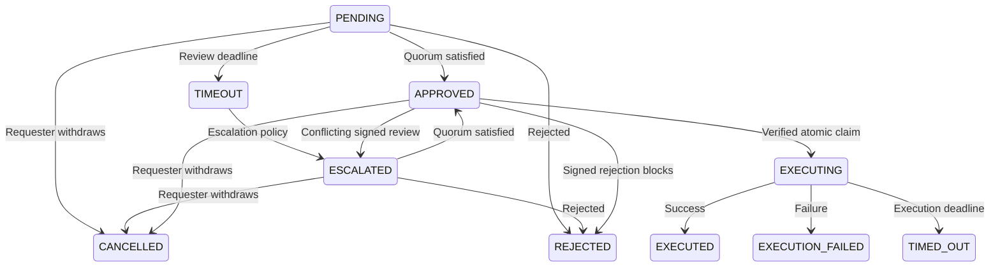

# Simultaneous Launch Button (slb)

[](https://golang.org)
[](LICENSE)
[](https://github.com/Dicklesworthstone/slb/actions)

A cross-platform CLI for reviewing potentially destructive commands from AI coding agents before execution.

When an agent wants to run something risky (e.g., `rm -rf`, `git push --force`, `kubectl delete`, `DROP TABLE`), `slb` requires peer review and explicit approval before execution.

**Choose the assurance level explicitly:** The default `independent` approval policy refuses local approvals and execution requiring independently authenticated reviewers. No external identity provider is implemented yet. Cooperating agents on one host can opt into `same_host` peer review, a **mistake-prevention workflow, not a security boundary**. This mode does not authenticate agent or model identities and cannot contain a malicious process sharing the same OS user. Requests, reviews, execution records, and history keep their policy labels; local reviews never become independent authorization. See [the identity boundary and deployment requirements](references/SECURITY.md#reviewer-identity-security-boundary-issue-30).

## Why This Exists

Coding agents can get tunnel vision, hallucinate, or misunderstand context. A second reviewer (ideally with a different model/tooling) catches mistakes before they become irreversible.

`slb` is built for **multi-agent workflows** where many agent terminals run in parallel and a single bad command could destroy work, data, or infrastructure.

## Key Features

- **Risk-Based Classification**: Commands are automatically classified by risk level
- **Client-Side Execution**: Commands run in YOUR shell environment (inheriting AWS credentials, kubeconfig, virtualenvs, etc.)
- **Command Hash Binding**: Approvals bind to the exact command via SHA-256 hash
- **SQLite Source of Truth**: Project state lives in `.slb/state.db`
- **Agent Mail Integration**: Notify reviewers and track audit trails via MCP Agent Mail
- **TUI Dashboard**: Interactive terminal UI for human reviewers

## Risk Tiers

| Tier | Approvals | Auto-approve | Examples |
|------|-----------|--------------|----------|
| **CRITICAL** | 2+ | Never | `rm -rf /`, `DROP DATABASE`, `terraform destroy`, `git push --force` |
| **DANGEROUS** | 1 | Never | `rm -rf ./build`, `git reset --hard`, `kubectl delete`, `DROP TABLE` |
| **CAUTION** | 0 | After 30s | `rm file.txt`, `git branch -d`, `npm uninstall` |
| **SAFE** | 0 | Immediately | `rm *.log`, `git stash`, `kubectl delete pod` |

These counts are review requirements. With the default `independent` policy,
local sessions cannot satisfy a requirement for independent approval. With
`same_host`, they count cooperating local reviewers under the limitations above.

## Quick Start

### Installation

#### Recommended: Homebrew (macOS/Linux)

```bash
brew install dicklesworthstone/tap/slb
```

This method provides:
- Automatic updates via `brew upgrade`
- Dependency management
- Easy uninstall via `brew uninstall`

#### Windows: Scoop

```powershell
scoop bucket add dicklesworthstone https://github.com/Dicklesworthstone/scoop-bucket
scoop install dicklesworthstone/slb
```

#### Alternative: Direct Download

Choose the matching archive from the [latest release](https://github.com/Dicklesworthstone/slb/releases/latest):

- Linux x86_64: `slb_<version>_linux_amd64.tar.gz`
- Linux ARM64: `slb_<version>_linux_arm64.tar.gz`
- macOS Intel: `slb_<version>_darwin_amd64.tar.gz`
- macOS ARM64: `slb_<version>_darwin_arm64.tar.gz`
- Windows x86_64: `slb_<version>_windows_amd64.zip`

Download `checksums.txt` from that same release and verify the archive's SHA-256
before extracting it. The archive contains `slb` on Linux/macOS or `slb.exe` on
Windows. Windows ARM64 archives are not currently published.

#### Alternative: Install Script

```bash
curl -fsSL "https://raw.githubusercontent.com/Dicklesworthstone/slb/main/scripts/install.sh?$(date +%s)" | bash
```

The installer verifies the archive against `checksums.txt` from the selected
release and reports the retained download workspace. Set `INSTALL_DIR` to choose
the destination. For qualification with a known scratch location,
`SLB_RETAIN_WORK_ROOT` may name an absolute path that does not exist yet and whose
parent already exists; it is created privately and retained on success or failure.

#### Build from Source

```bash
git clone https://github.com/Dicklesworthstone/slb.git
cd slb && make build
```

#### Go Install

```bash
go install github.com/Dicklesworthstone/slb/cmd/slb@latest
```

### Initialize a Project

```bash
cd /path/to/your/project
slb init
```

This creates a `.slb/` directory with:
- `state.db` - SQLite database for requests, reviews, and sessions
- `config.toml` - Project-specific configuration
- `pending/` - JSON files for pending requests (for watching/interop)

### Working from Subdirectories

Ordinary commands discover the nearest initialized project from `-C` /
`--project`, then `SLB_PROJECT`, then the current directory. For example, a
session started at a repository root can submit a request from `src/` and use
the root project's database, configuration, and custom patterns. Reviewers at
the root see that same request.

Project discovery does not change the command's working directory. `-C` changes
into the explicitly selected directory before discovery; `SLB_PROJECT` selects
the project without changing cwd. Requests bind the exact command directory,
and approved execution uses that recorded directory even when invoked elsewhere.
Default foreground, background, and emergency logs belong to the owning project's
`.slb/logs/`. An explicit `--log-dir` remains relative to the invoking directory.

`slb init` intentionally initializes the selected directory itself, allowing a
separate nested project. An existing nested `.slb` marks a project boundary;
malformed or inaccessible markers and missing policy databases cause an error,
instead of silently creating another database or using a home history store.
An explicit `--db` still selects the requested database.

Discovery follows filesystem aliases before selecting policy. Existing literal
project aliases are retained when they identify that same physical root; an alias
into another project's descendant uses the target project's policy. Stored
session, request, and review bindings are never rewritten by discovery.
When a selected root alias has its own recorded request identity, `slb watch`
uses local polling to retain that exact scope.

### Same-Host Peer-Review Workflow

Enable this only when the agents cooperate and you want a second session to
check for mistakes. From the initialized project, opt in before creating requests:

```bash
slb config set general.approval_policy same_host
```

This writes `approval_policy = "same_host"` under `[general]` in
`.slb/config.toml`. The default is `"independent"`. Each request keeps the policy
under which it was created; changing configuration does not convert existing
requests or reviews. Both approving a request and executing it require the current
policy to match. Set it back to `independent` to disable local approval and
execution of outstanding same-host requests.

```bash
# 1. Each agent starts a session and retains its own returned ID and key.
slb session start --agent "Requester" --program "claude-code" --model "opus"
slb session start --agent "Reviewer" --program "codex-cli" --model "codex"

# 2. The requester explains the exact command and its intended effects.
slb request "rm -rf ./build" --session-id <requester-id> \
  --reason "Clean generated artifacts before a fresh compile" \
  --expected-effect "Remove only this project's build directory" \
  --safety "Source files are outside build; all outputs can be regenerated"

# 3. A different agent inspects the command, working directory and explanation.
slb show <request-id>
slb approve <request-id> --session-id <reviewer-id> --session-key <reviewer-key> \
  --comments "Checked the working directory and build contents"

# 4. The requester executes only after the required reviews are recorded.
slb execute <request-id> --session-id <requester-id>
```

The output identifies these as same-host reviews, not independently
authenticated authorization. Quorum, different-model checks when configured,
signatures, expiry, and command binding still apply. The requester cannot review
its own request, including through a restarted session with the same agent name
or the `trusted_self_approve` setting. Names and model labels remain self-reported.
`slb run` provides the same workflow while waiting and executing automatically
after review.

Another eligible reviewer can still record an objection after quorum is reached,
until SLB commits the execution or authorization claim. The current
[conflict policy](#conflict-resolution) determines whether that objection rejects,
escalates, or leaves the request approved. A negative vote never grants a new
approval or renews an existing deadline.

## Commands Reference

### Session Management

```bash
slb session start --agent <name> --program <prog> --model <model>
slb session end --session-id <id>
slb session resume --agent <name> --session-id <id> --session-key <key>  # Resume after crash
slb session list                               # Show active sessions
slb session heartbeat --session-id <id>        # Keep session alive
```

### Request & Run

```bash
# Primary command (atomic: check, request, wait, execute)
slb run "<command>" --reason "..." [--session-id <id>]

# Plumbing commands
slb request "<command>" --reason "..."         # Create request only
slb status <request-id> [--wait]               # Check status
slb pending [--all-projects]                   # List pending requests
slb cancel <request-id>                        # Cancel own request
```

### Review & Approve

```bash
slb review <request-id>                        # Show full details
slb approve <request-id> --session-id <id> --session-key <key>  # Review under the request's policy
slb reject <request-id> --session-id <id> --session-key <key> --reason "..."
```

### Execution

```bash
slb execute <request-id>                       # Execute approved request
slb emergency-execute "<cmd>" --reason "..."   # Unreviewed override (logged)
slb rollback <request-id>                      # Rollback if captured
```

### Pattern Management

```bash
slb patterns list [--tier critical|dangerous|caution|safe]
slb patterns test "<command>"                  # Check what tier a command would be
slb patterns add --tier dangerous "<pattern>"  # Agents can add patterns
```

### Daemon & TUI

```bash
slb daemon start [--foreground]                # Start background daemon
slb daemon stop                                # Stop daemon
slb daemon status                              # Check daemon status
slb tui                                        # Launch interactive TUI
slb watch --session-id <id> --json             # Stream events for agents
```

## Configuration

Configuration is hierarchical (lowest to highest priority):
1. Built-in defaults
2. User config (`~/.slb/config.toml`)
3. Project config (`.slb/config.toml`)
4. Environment variables (`SLB_*`)
5. Command-line flags

### Example Configuration

```toml
[general]
approval_policy = "independent"    # Default; "same_host" explicitly opts into local workflow review
min_approvals = 2
request_timeout = 1800              # 30 minutes
approval_ttl_minutes = 30
timeout_action = "escalate"         # or "auto_reject", "auto_approve_warn"

[rate_limits]
max_pending_per_session = 5
max_requests_per_minute = 10

[notifications]
desktop_enabled = true
desktop_delay_seconds = 60

[daemon]
tcp_addr = ""                       # For Docker/remote agents
tcp_require_auth = true
```

## Default Patterns

### CRITICAL (2+ approvals)

| Pattern | Description |
|---------|-------------|
| `rm -rf /...` | Recursive deletion of `/`, system paths, or home roots (`/home`, `/home/user`, `/Users/user`, `/root`, `~`) |
| `DROP DATABASE/SCHEMA` | SQL database destruction |
| `TRUNCATE [TABLE] [ONLY] ...` | SQL data destruction (TABLE is optional) |
| `terraform destroy` | Infrastructure destruction |
| `kubectl delete node/namespace/pv/pvc` | Kubernetes critical resources |
| `git push --force`, `git push origin +main` | Force push (not with-lease), including `+` refspecs |
| `aws terminate-instances` | Cloud resource destruction |
| `dd ... of=/dev/` | Direct disk writes |

### DANGEROUS (1 approval)

| Pattern | Description |
|---------|-------------|
| `rm -rf` | Recursive force delete |
| `git reset --hard` | Discard all changes |
| `git clean -fd` | Remove untracked files |
| `kubectl delete` | Delete Kubernetes resources |
| `curl ... \| bash`, `bash <(curl ...)` | Downloaded script run by a shell |
| `terraform destroy -target` | Targeted destroy |
| `DROP TABLE` | SQL table destruction |
| `chmod -R`, `chown -R` | Recursive permission changes |

For deletion, `-r`, `-R`, and `--recursive` express recursive intent; `-f`
alone remains CAUTION. Project descendants such as `/home/user/project/build`
are DANGEROUS, while home roots and system directories remain CRITICAL.
`build` and `./build` resolve against the same working directory, and any
protected operand makes a recursive deletion CRITICAL.

### CAUTION (auto-approved after 30s)

| Pattern | Description |
|---------|-------------|
| `rm <file>` | Single file deletion |
| `git stash drop` | Discard stashed changes |
| `git branch -d` | Delete local branch |
| `npm/pip uninstall` | Package removal |

### SAFE (skip review)

| Pattern | Description |
|---------|-------------|
| `rm *.log`, `rm *.tmp`, `rm *.bak` | Temporary file cleanup |
| `git stash` | Stash changes (not drop) |
| `kubectl delete pod` | Pod deletion (pods are ephemeral) |
| `npm cache clean` | Cache cleanup |

## IDE Integration

### Claude Code Hooks

Add to your `AGENTS.md`:

```markdown
## SLB Integration

Before running any destructive command, use slb:

\`\`\`bash
# Instead of running directly:
rm -rf ./build

# Use slb:
slb run "rm -rf ./build" --reason "Clean build before fresh compile"
\`\`\`

All DANGEROUS and CRITICAL commands must go through slb review.
```

Install the Claude Code hook for the selected project:

```bash
slb init                    # Once per project, before project hook installation
slb hook install
slb hook status

# Or install for all projects in your user settings:
slb hook install --global
```

The `slb integrations claude-hooks --install` entry point uses the same installer.
Use `slb integrations claude-hooks --preview` to print a current `PreToolUse`
settings fragment without changing files. See [hook installation and scopes](#claude-code-hook-integration).

### Cursor Rules

Generate Cursor rules:

```bash
slb integrations cursor-rules > .cursorrules
```

## Shell Completions

```bash
# zsh (~/.zshrc)
eval "$(slb completion zsh)"

# bash (~/.bashrc)
eval "$(slb completion bash)"

# fish (~/.config/fish/config.fish)
slb completion fish | source
```

## Architecture

```
.slb/
├── state.db          # SQLite database (source of truth)
├── config.toml       # Project configuration
├── pending/          # JSON snapshots for watching
│   └── req-<uuid>.json
├── sessions/         # Session files
└── logs/             # Execution logs
    └── req-<uuid>.log
```

**Key Design Decision**: Client-side execution. The daemon checks review evidence and policy; it is not an independently protected authorization service. Commands execute in the calling process's shell environment to inherit:
- AWS_PROFILE, AWS_ACCESS_KEY_ID
- KUBECONFIG
- Activated virtualenvs
- SSH_AUTH_SOCK
- Database connection strings

## Troubleshooting

### "Daemon not running" warning

This is expected - slb works without the daemon (file-based polling). Start the daemon for real-time updates:

```bash
slb daemon start
```

### "Active session already exists"

Resume it with the session ID and key that `slb session start` printed:

```bash
slb session resume --agent "YourAgent" --session-id <id> --session-key <key>
```

slb stores only a digest of the key and cannot print it again. If the key is
lost, end that session and start a new one:

```bash
slb session end --session-id <id>
slb session start --agent "YourAgent" --program <prog> --model <model>
```

### Approval expired

Approvals have a TTL (30min default, 10min for CRITICAL). Re-request if expired:

```bash
slb run "<command>" --reason "..."  # Creates new request
```

### Command hash mismatch

The command was modified after review. Submit a new request for the modified
command; changing its stored hash does not make the existing signed review valid.

## Safety Note

`slb` adds friction and peer review for dangerous actions. It does NOT replace:
- Least-privilege credentials
- Environment safeguards
- Proper access controls
- Backup strategies

Use slb as **defense in depth**, not your only protection.

## Claude Code Hook Integration

To integrate with Claude Code, `slb` provides a PreToolUse hook that intercepts Bash commands before execution.

### Quick Setup

```bash
# Initialize the project's policy and state database first
slb init

# Install in the current project's .claude/settings.json
slb hook install

# Check that same project installation
slb hook status

# Test classification without executing
slb hook test "rm -rf ./build"

# Select a different project, or install for all projects
slb -C /path/to/project init
slb -C /path/to/project hook install
slb hook install --global
```

### Installation Scope

`install`, `status`, and `uninstall` operate on the selected project by default.
Discovery starts at `-C` / `--project`, then `SLB_PROJECT`, then the current
working directory and selects the nearest initialized project. Installing from
`src/` therefore updates that project's root settings and hook files. Add
`--global` to operate on your user installation instead.

Project installation requires a readable, initialized
`<project>/.slb/state.db`. Initialize a new project with `slb init` first; restore
or repair missing or unreadable state in an existing project before installing.
The installer checks this prerequisite before changing settings or creating a
fallback script. A global registration can be installed without initializing a
project; its native guard still applies the current policy checks for each tool call.

| Scope | Claude Code registration | Standalone fallback script |
|-------|--------------------------|----------------------------|
| Project (default) | `<project>/.claude/settings.json` | `<project>/.slb/hooks/slb_guard.py` |
| Global (`--global`) | `~/.claude/settings.json` | `~/.slb/hooks/slb_guard.py` |

SLB updates its own `PreToolUse` hook and preserves other settings, other hook
events, and neighboring hooks in the same `Bash` entry. Reinstalling an unchanged
registration leaves the settings file unchanged. `--force` or `--merge=false`
resets only SLB's own hook options. Uninstalling removes the selected registration
and keeps the script file; it does not edit the other scope.

Earlier versions of `slb hook install` always wrote user settings. Inspect that
existing installation with `slb hook status --global`; use
`slb hook uninstall --global` if you choose to remove it. Project status reports
the project registration, even when a global registration is also present.

Generated registrations include `onFailure: "block"`. Claude Code **v2.1.295 or
later** supports this setting to block an action when its hook cannot start,
fails, or times out. See the [Claude Code hook failure documentation](https://code.claude.com/docs/en/hooks#block-the-action-when-a-hook-fails).

### How It Works

1. **Native guard**: Claude Code invokes the installed `slb hook guard` command with the Bash tool input. The generated Python script is available separately as a standalone fallback.
2. **Current policy**: The guard uses the command's working directory to load project policy and find the project daemon.
3. **Review and execution**: A reviewed command is handed to SLB's execution path, which rechecks its command binding, policy, review evidence, and expiration before claiming execution.
4. **Offline behavior**: When the daemon is unavailable, the native guard classifies locally and blocks commands that require review.

Installing a hook leaves `general.approval_policy` unchanged. The optional
`same_host` policy remains a mistake-prevention workflow, with no independently
authenticated reviewer identity or operating-system security boundary.

### Explicit Policy Files

When your workflow uses a separate configuration file, select the same file for
installation, the daemon, requests, and reviews:

```bash
slb -C /path/to/project --config /path/to/review-policy.toml hook install
slb -C /path/to/project --config /path/to/review-policy.toml daemon start
slb -C /path/to/project --config /path/to/review-policy.toml request "<command>" --reason "..." --session-id <requester-id>
slb -C /path/to/project --config /path/to/review-policy.toml approve <request-id> --session-id <reviewer-id> --session-key <key>
```

The installed registration retains the absolute filename and its owning physical
project. The hook reloads that file for offline classification and passes it to
the executor when handing off a reviewed command. Equivalent file aliases may
connect to the same daemon, but the handoff retains the hook's selected filename
so later replacement of that file still takes effect. Missing or invalid selected
files block the action. A daemon started with a different configuration must be
restarted with the selected file; a hook query cannot change its policy.

The binding applies only to the owning project, including for a global hook.
A separately initialized nested project uses its own policy. The generated Python
artifact also retains the binding and uses the native guard to read current
configuration; it blocks if that guard is unavailable. An artifact generated
without an explicit file retains its embedded offline snapshot behavior.

Execution still reloads policy and verifies the exact request, signatures,
quorum and expiry. Opting out of `same_host` after a hook lookup prevents the
outstanding handoff from executing; it never upgrades the original reviews.

### Hook Commands

```bash
slb hook generate                         # Generate standalone fallback script
slb hook install [--global]               # Install in the selected scope
slb hook uninstall [--global]             # Remove only that registration
slb hook status [--global]                # Inspect that scope's installation
slb hook test "<command>"                 # Test classification without executing
slb integrations claude-hooks --preview   # Print a PreToolUse settings fragment
slb integrations claude-hooks --install [--global]  # Same scoped installer
```

The guard returns Claude Code's `PreToolUse` permission decision:

- `allow`: The tool call may proceed, subject to Claude Code's other permissions.
- `ask`: Claude Code requests a decision, for example under a configured CAUTION policy.
- `deny`: The tool call is blocked with guidance for requesting SLB review.

## Pattern Matching Engine

The pattern matching engine is the core of `slb`'s command classification system.

### Classification Algorithm

1. **Normalization**: Commands are parsed using shell-aware tokenization
   - Strips wrapper prefixes: `sudo`, `doas`, `env`, `time`, `nohup`, etc.
   - Extracts inner commands from `bash -c 'command'` patterns
   - Resolves paths: `./foo` → `/absolute/path/foo`

2. **Compound Command Handling**: Commands with `;`, `&&`, `||`, `|` are split and each segment is classified independently. The **highest risk segment determines the overall tier**.
   ```
   echo "done" && rm -rf /etc    →  CRITICAL (rm -rf /etc wins)
   ls && git status              →  SAFE (no dangerous patterns)
   ```

3. **Shell-Aware Splitting**: Separators inside quotes are preserved:
   ```
   psql -c "DELETE FROM users; DROP TABLE x;"  →  Single segment (SQL)
   echo "foo" && rm -rf /tmp                   →  Two segments
   ```

4. **Pattern Precedence**: Patterns are checked in order: SAFE → CRITICAL → DANGEROUS → CAUTION
   - First match wins within each tier
   - SAFE patterns skip review entirely

5. **Fail-Safe Parse Handling**: If command parsing fails (unbalanced quotes, complex escapes), the tier is **upgraded by one level**:
   - SAFE → CAUTION
   - CAUTION → DANGEROUS
   - DANGEROUS → CRITICAL

Shell redirections that create, truncate or append to a file receive at least
CAUTION, even when the invoked program matches a SAFE rule. For example,
`git stash > important.sql` can truncate the file before Git starts. The current
CAUTION policy therefore applies; stronger DANGEROUS or CRITICAL matches remain.
This check also follows nested shell programs and considers every redirection,
including a file target later superseded by `/dev/null`. Literal `/dev/null`,
file-descriptor duplication/closing and input-only redirects retain their normal
classification. Classification never executes the command or inspects its files.

### Fallback Detection

For commands that wrap SQL (e.g., `psql -c "..."`, `mysql -e "..."`), pattern matching may not catch embedded statements. The engine includes fallback detection:

```
DELETE FROM ... (no WHERE clause)  →  CRITICAL
DELETE FROM ... WHERE ...          →  DANGEROUS
```

### Runtime Pattern Management

Agents can add patterns at runtime:

```bash
slb patterns add --tier dangerous "docker system prune"
slb patterns list --tier critical
slb patterns test "kubectl delete deployment nginx"
```

Pattern changes are persisted to SQLite and take effect immediately.

## Request Lifecycle

Requests follow a well-defined state machine with strict transition rules.

### State Diagram



### Recovering Escalated Requests

`slb pending` and `slb review list` include both pending and escalated requests,
with an explicit `status` in each row. Their project and review-pool filters
apply to both states. Escalation keeps the original command binding, approval
policy, quorum and different-model requirement; another eligible reviewer can
inspect the request and complete its review.

The requester can withdraw a pending, approved or escalated request using
`slb cancel <request-id> --session-id <requester-id>`. Cancellation checks ownership
and current state in one transaction. It cannot overwrite an executing or terminal
request. Existing signed reviews remain available in history, and the durable
event journal records the transition with the original policy and review counts.
Withdrawing an escalated request also resolves that request's block on session
identity rotation. Escalated rows do not count as pending quota or re-enter pending
timeout scans merely because they remain visible in reviewer queues.

### Terminal States

Once a request reaches a terminal state, no further transitions are allowed:
- **EXECUTED**: Command completed successfully
- **EXECUTION_FAILED**: Command returned non-zero exit code
- **TIMED_OUT**: Command exceeded execution timeout
- **CANCELLED**: Request was cancelled by the requester
- **REJECTED**: Request was rejected by a reviewer

### Approval TTL

Approvals have a time-to-live to prevent stale approvals:
- **Standard requests**: 30 minutes (configurable)
- **CRITICAL requests**: 10 minutes (stricter by default)

If an approval expires before execution, submit a new request for review.

The decisive review loads the current TTL after obtaining the database writer
reservation and reauthenticating any delegated reviewer. Execution also applies
the current TTL to the original approval time: the effective deadline is the
earlier of that result and the recorded approval expiry. Shortening the TTL can
therefore revoke an outstanding approval; lengthening it cannot extend the
recorded grant. SLB repeats this check during the atomic execution claim, even if
a SAFE rule now matches the command. These checks do not rewrite review history.
A reviewed request with a missing or invalid approval timestamp must be submitted
again for fresh review.

## Execution Verification

Before a reviewed command executes, its policy and supporting evidence must
verify in addition to these execution checks. `same_host` evidence is accepted
only for a same-host request while that policy remains enabled. The default
`independent` policy continues to refuse local approvals, including historical
ones. An `approved` status alone is never an execution permit.

### Gate 1: Status Check
Request must be in APPROVED state.

### Gate 2: Approval Expiry
Approval TTL must not have elapsed.

### Gate 3: Command Hash
SHA-256 hash of the command must match. This ensures the exact approved command is executed, with no modifications allowed after approval.

### Gate 4: Tier Consistency
Risk tier must still match (patterns may have changed since approval).

### Gate 5: First-Executor-Wins
Only one executor can claim the request. Atomic database transition prevents race conditions when multiple agents try to execute.

## Dry Run & Rollback

### Dry Run Pre-flight

For supported literal command forms, `slb` gathers advisory evidence before
admitting the request:

| Requested command | Preview |
|---|---|
| `kubectl delete` | Forces `--dry-run=client`, retaining the selected resources and supported scope flags |
| `terraform destroy` | Runs `plan -destroy -input=false`, retaining variables, targets and supported `-chdir` selection |
| `rm` | Lists the literal target paths with `ls -la --` |
| `git reset` | Inspects the requested ref, index and working-tree changes according to the reset mode |
| `helm uninstall` | Gets the selected release's manifest with its context and namespace |

A preview is evidence for the reviewer, not an approval or a sandbox. Use
`--require-dry-run` to refuse admission when a preview is unsupported, fails or
times out.

Git reset previews default to `HEAD` when no target is supplied. Soft resets
show the ref change; mixed/default resets also show the index changes. Hard
resets additionally show tracked working-tree changes and inventories of
untracked and ignored paths, including when invoked from a subdirectory.
Merge/keep previews label candidate differences and explain that Git's
preservation and abort rules still apply. Inventories do not simulate every
untracked-path collision, and the repository can change after inspection.

Pathspec, interactive, recursive-submodule and ambiguous reset forms are
declined. Working-tree previews also decline configured clean/process filters
and implicit recursive-submodule behavior. Preview diffs disable external diff,
text conversion and filesystem-monitor programs, and preserve the normal time
and output limits.

Enable in config:
```toml
[general]
enable_dry_run = true
```

### Rollback State Capture

Before executing, `slb` can capture state for potential rollback:

```toml
[general]
enable_rollback_capture = true
max_rollback_size_mb = 100
```

Each execution attempt captures fresh state. Its recovery path is recorded
atomically with the successful execution claim, so a refused or competing
attempt cannot replace the winning execution's snapshot. Retrying after a
failed preflight captures the current state again. An execution without capture
does not inherit a snapshot left by an earlier preflight.

Captured state includes:
- **Filesystem**: Tar archive of affected paths
- **Git**: HEAD commit, branch, dirty state, untracked files
- **Kubernetes**: Private JSON manifests of explicitly named resources, bound to
  their context, namespace, API server and kubeconfig fingerprints

Rollback:
```bash
slb rollback <request-id>           # Restore captured state
slb rollback <request-id> --force   # Force overwrite
```

Request-based rollback requires the request's selected project (`-C` when
needed). Equivalent filesystem aliases are accepted without changing stored
project identity. Before restoration, the snapshot must match the request ID,
project, raw command and working directory. New metadata version 2 also binds
the complete command hash, including argv and shell mode. Historical version 1
metadata keeps its original identity checks and is not rewritten into stronger
evidence. `--force` does not bypass project, identity or version checks.

Both capture and recovery enforce a 4 MiB metadata limit. Recovery reads a
bounded regular metadata file and uses the selected snapshot directory for its
archive and patches; a copied metadata path cannot select another capture.
These are local consistency checks, not reviewer authentication or a new
execution authorization. A failed restoration does not mark the request as
rolled back. Explicit Git `--from` recovery retains its separate database-free
workflow and required `--force` acknowledgement.

Filesystem recovery validates the complete archive and all destination paths
before changing live files. Damaged gzip data, incomplete payloads, unsupported
entries, conflicting roots and symlinked destination ancestors are refused;
`--force` does not waive these checks. Valid version-1 snapshots, empty captures
and identical overlapping targets retain their existing format. Decoding is
bounded by the recorded payload size, 100,000 entries and 64 MiB of archive
metadata/padding. Stop concurrent writers before restoring: these checks are
preflight validation, not an atomic filesystem transaction, and a later I/O
failure or concurrent path change can still interrupt restoration.

Kubernetes capture supports literal `kubectl delete` commands with named
`type/name` or `type name` targets. Context, kubeconfig and namespace flags can
appear before or after `delete`; ordinary force, wait, grace-period, cascade and
timeout controls are supported. Selectors, `--all`, all namespaces, file/stdin
or kustomize selections, and unsupported connection/authentication overrides
are refused instead of producing a partial backup. A file-backed kubeconfig is
required, and kuberc preferences must be disabled when present.

Recovery validates the entire manifest set and the original configuration
before writing to the captured target. It creates resources by default;
`--force` permits applying over existing resources but does not bypass target
or integrity checks. Changed kubeconfig files, including context or credential
changes, require deliberate target reconciliation. Historical manifests without
target bindings remain available on disk for manual recovery; they are not
automatically applied to the current cluster.

Kubernetes snapshots cover at most 256 named objects, 16 MiB per object and
100 MiB total; a lower `max_rollback_size_mb` is honored. Resource manifests can
contain application secrets and are stored in private directories/files
(`0700`/`0600`). Kubeconfig contents and authentication material are not copied
into metadata. Recovery restores the named objects, not namespace contents,
cascaded dependents, ownership graphs or persistent-volume data. It is not an
atomic cluster-wide transaction: concurrent changes and partial API failures
still require inspection.

## Daemon Architecture

The daemon provides real-time notifications and execution verification.

### IPC Communication

Primary communication uses Unix domain sockets:
```
/tmp/slb-<hash>.sock
```

The socket and PID file (`/tmp/slb-<hash>.pid`) use the same hash of the discovered project root, allowing independent project daemons to coexist. Both files use the system temporary directory, including `TMPDIR` when set. Use `-C /path/to/project` with `slb daemon start`, `stop`, or `status` to select a project. Selection falls back to `SLB_PROJECT`, then the working directory; all three resolve symlink aliases and discover the nearest ancestor containing `.slb`, so commands also work from nested directories. If no ancestor contains `.slb`, the selected directory is the project root.

Lifecycle commands manage the local project daemon regardless of `SLB_HOST`. Companion `.pid.lock` and `.sock.lock` files remain after shutdown by design; leave them in place so daemon ownership remains coordinated across starts and stops.

When upgrading from a version with the shared per-user PID file, stop any existing daemon through its original foreground session or process manager, then restart it with the new version. The socket naming format and client IPC remain compatible. The new `stop` command requires project-aware shutdown support and deliberately refuses to signal a process from the old shared PID file.

### JSON-RPC Protocol

All daemon communication uses JSON-RPC 2.0:

```json
{"jsonrpc": "2.0", "method": "hook_query", "params": {"command": "rm -rf /"}, "id": 1}
```

Available methods:
- `hook_query` - Classify command and check approvals
- `hook_health` - Health check with pattern hash
- `verify_execution` - Check execution gates
- `subscribe` - Subscribe to request events

### TCP Mode (Docker/Remote)

For agents in containers or remote machines:

```toml
[daemon]
tcp_addr = "0.0.0.0:9876"
tcp_require_auth = true
tcp_allowed_ips = ["192.168.1.0/24"]
```

### Timeout Handling

When a request's approval window expires:

| Action | Behavior |
|--------|----------|
| `escalate` | Transition to ESCALATED, notify humans (default) |
| `auto_reject` | Automatically reject the request |
| `auto_approve_warn` | Auto-approve CAUTION tier with warning notification |

```toml
[general]
timeout_action = "escalate"
```

### Desktop Notifications

Pending-request desktop alerts use macOS AppleScript or Linux `notify-send`:

```toml
[notifications]
desktop_enabled = true
desktop_delay_seconds = 60    # Wait before first notification
```

Desktop and webhook delivery are tracked independently. A failed destination is
retried with backoff starting at 15 seconds and capped at five minutes, with a
shared budget of 60 attempted sends per minute. Successful destinations are not
resent while the daemon remains running, and pending-alert retries stop when the
request leaves the pending state. This suppression state is in memory, so a
daemon restart can repeat a still-pending alert.

Desktop helpers have a five-second deadline, bounded output capture and a
one-second pipe-drain limit. Daemon cancellation interrupts ordinary helper
process groups instead of waiting indefinitely. Pending desktop alerts are not
implemented on Windows; timeout alerts retain their separate PowerShell path.
Notifications remain advisory and never count as approval evidence.

## Advanced Configuration

### Cross-Project Reviews

Allow reviewers from other projects:

```toml
[general]
cross_project_reviews = true
review_pool = ["agent-a", "agent-b", "human-reviewer"]
```

### Trusted Self-Approval

This legacy setting does not enable production self-approval: the default
`independent` policy still needs an external identity authority, and `same_host`
always requires another agent. A trusted name cannot supply a peer review.

```toml
[agents]
trusted_self_approve = ["senior-agent", "lead-developer"]
trusted_self_approve_delay_seconds = 300    # 5 minute delay
```

### Conflict Resolution

When approvals and rejections conflict:

```toml
[general]
conflict_resolution = "any_rejection_blocks"  # Default
# Options: any_rejection_blocks | first_wins | human_breaks_tie
```

Both approvals and rejections use the current conflict settings when the vote is
committed. An eligible reviewer who has not already voted may reject an approved
request until its execution or authorization claim is committed:

| Current policy | Effect of a later rejection on an approved request |
|----------------|---------------------------------------------------|
| `any_rejection_blocks` | Changes the request to `rejected` |
| `human_breaks_tie` | Changes the request to `escalated` |
| `first_wins` | Keeps an earlier affirmative decision `approved`, with its original approval timestamp and expiry |

The vote and claim compete for the same database writer reservation. A rejection
that commits first is considered by the claim; once the claim commits, further
review is refused. This boundary precedes process startup and also applies to
native Git authorization. A reviewer cannot replace a previous vote, and further
approvals cannot refresh an already approved request.

An expired approval may still receive an objection, but that objection cannot
revive it. Changing conflict settings and then submitting a negative vote cannot
newly approve a pending or escalated request; resolving it to approved requires
a fresh affirmative review. Opting out of same-host approval does not prevent
an otherwise eligible reviewer from rejecting an outstanding request, and the
review retains the request's original assurance category.

CLI JSON always includes `request_status` alongside the vote's `decision` and
`assurance`. The change-only fields still indicate whether this vote changed the
request's state. CLI, TUI, and review notifications distinguish a recorded vote
from the resulting request status, including a nondecisive `first_wins` rejection.

### Different Model Requirement

Require reviewers to report a different AI model:

```toml
[general]
require_different_model = true
different_model_timeout = 300    # Escalate to human after 5 min
```

In `same_host` mode this compares session model labels. It helps cooperating
agents choose another model, but does not authenticate which model produced a review.

### Rate Limiting

Prevent request floods:

```toml
[rate_limits]
max_pending_per_session = 5      # Max concurrent pending requests
max_requests_per_minute = 10     # Rate limit per session
rate_limit_action = "reject"     # reject | queue | warn
```

Queue mode waits for capacity before creating a request. Use `--queue-timeout`
to bound that wait separately from `--timeout`, which bounds waiting for a
review decision. `general.request_timeout` is measured in seconds without
rounding to minutes, and the new request receives its full lifetime after
admission preparation.

Admission also resolves the requester's expired pending work without requiring
a daemon. It applies the current timeout policy and records the resulting
timeout or escalation; it never treats expiration as a peer approval. Pending
capacity can then be reused, while the per-minute request count remains intact.
Other requesters' work is unaffected, and invalid policy stops admission.

### Dynamic Quorum

Scale approval requirements based on active reviewers:

```toml
[patterns.critical]
dynamic_quorum = true
dynamic_quorum_floor = 2    # Minimum approvals even with few reviewers
```

### Webhook Notifications

Send events to external systems:

```toml
[notifications]
webhook_url = "https://slack.com/webhook/..."
```

Payload includes request details, classification, and event type.

## Security Design Principles

### Defense in Depth

`slb` implements multiple checks for the selected review policy. In `same_host`
mode they prevent workflow mistakes, not malicious actions by the same OS user:

1. **Pattern-based classification** - First line of defense
2. **Peer review requirement** - Human/agent oversight
3. **Command hash binding** - Tamper detection
4. **Approval TTL** - Prevent stale approvals
5. **Execution verification gates** - Pre-execution checks
6. **Audit logging** - Full traceability

### Cryptographic Guarantees

- **Command binding**: SHA-256 hash computed at request time, verified at execution
- **Review signatures**: HMAC-SHA256 keyed with the digest of the reviewer's session key. Same-host evidence uses a separate signature format that binds the decision to the exact command and review policy. Relabeling the policy or replacing the command invalidates that evidence. A holder of the signing material, including a process that can read the database, can still forge local reviews; a signature does not establish an independent principal.
- **Session keys**: Generated per session and shown once, by `slb session start` (or by `slb session resume` when it creates or rotates a session). SQLite stores only a SHA-256 digest of each key, and supplied keys are compared with it in constant time, so a copy or backup of `state.db` does not contain a key slb will accept. Upgrading converts existing keys in place and then rebuilds the file, so no old copy of a key is left in it; agents keep using the keys they hold. Hashing protects copies of the database. It does not separate agents that run as the same OS user: such a process can read another agent's key from its environment, files or terminal, write the database, or run commands directly. See [the identity boundary](references/SECURITY.md#reviewer-identity-security-boundary-issue-30).
- **Session recovery**: Resuming an existing session requires its original `--session-id` and `--session-key`, including with `--force`. Names, programs, and models are not recovery credentials. slb cannot return a lost key, because it does not have it; start a new session instead.

### Fail-Closed Behavior

When components fail:
- Daemon unreachable, or no answer within `integrations.hook_query_timeout_ms`
  (default 250ms) → the hook classifies locally: dangerous/critical commands are
  blocked and commands no pattern covers require confirmation. The audit source
  is `hook_native_timeout` for a deadline and `hook_native_offline` otherwise
- Parse error → Upgrade tier by one level
- Approval expired → Require new approval
- Hash mismatch → Reject execution

### Audit Trail

Every action is logged to SQLite with:
- Timestamp
- Actor (session ID, agent name)
- Action type
- Request/review details
- Approval policy and review assurance (same-host workflow reviews remain labeled)
- Outcome

Query history:
```bash
slb history [--days 7] [--session <id>] [--status executed]
```

## Environment Variables

All config options can be set via environment:

| Variable | Description |
|----------|-------------|
| `SLB_APPROVAL_POLICY` | `independent` (default) or explicitly opt into low-assurance `same_host` review |
| `SLB_MIN_APPROVALS` | Minimum approval count |
| `SLB_REQUEST_TIMEOUT` | Request timeout in seconds |
| `SLB_TIMEOUT_ACTION` | What to do on timeout |
| `SLB_DESKTOP_NOTIFICATIONS` | Enable desktop notifications |
| `SLB_WEBHOOK_URL` | Webhook notification URL |
| `SLB_DAEMON_TCP_ADDR` | TCP listen address |
| `SLB_TRUSTED_SELF_APPROVE` | Comma-separated trusted agents |
| `SLB_HOOK_QUERY_TIMEOUT_MS` | Native hook daemon-query deadline in ms (10-10000, default 250) |

## Agent Event Streaming

The `slb watch` command provides real-time event streaming for agent workflows.

### Event Stream Format

Events are streamed as newline-delimited JSON (NDJSON) for easy programmatic consumption:

```bash
slb watch --session-id <id>
```

Selected fields from the event stream:
```json
{"event":"request_pending","request_id":"abc123","status":"pending","risk_tier":"dangerous","approvals":0,"min_approvals":1,"approval_policy":"same_host","review_notice":"same-host peer review (low assurance; not independently authenticated authorization)"}
{"event":"request_approved","request_id":"abc123","status":"approved","approvals":1,"min_approvals":1,"approval_policy":"same_host"}
{"event":"request_executed","request_id":"abc123","status":"executed","exit_code":0,"approval_policy":"same_host","execution_assurance":"same_host"}
```

Request events also carry the project, redacted command display, command hash,
requester, rejection count, original `created_at` and any `resolved_at` timestamp.
`observed_at` records when the state was observed; it does not replace creation
time. The approval policy and its `review_notice` remain present throughout the
workflow, with stored execution assurance when available. Submitted vote counts
are display information, not verified execution permission. Use `slb execute` to
apply the current policy and verify the evidence.

### Event Types

| Event | Description |
|-------|-------------|
| `request_pending` | Request awaiting review, including changed vote counts |
| `request_approved` | Request was approved |
| `request_rejected` | Request was rejected |
| `request_executing` | Execution was claimed |
| `request_executed` | Command completed successfully |
| `request_execution_failed` | Execution failed |
| `request_timed_out` | Command execution timed out |
| `request_timeout` | Request timed out waiting for approval |
| `request_escalated` | Request was escalated |
| `request_cancelled` | Request was cancelled |

### Transport Modes

**Daemon IPC (preferred)**: Real-time streaming via Unix socket subscription when the daemon is running.

**Polling fallback**: If the daemon is unavailable, the command falls back to database polling at configurable intervals:

```bash
slb watch --poll-interval 5s
```

Both transports start with the selected project's unresolved requests and
completions from the last 15 minutes. A lost daemon connection emits
`watch_degraded` before polling resumes from the current database state.
Previously observed active requests remain tracked through their final state,
including an outcome older than the normal window after a long disconnect.
Old terminal requests then retire from the live watch state. Snapshots larger
than 10,000 requests fail explicitly instead of silently dropping records.

Default local discovery uses the nearest physical project containing `.slb`,
including from a subdirectory or symlink, and pins that project's database for
fallback. An explicit `--db` selects local polling and keeps that database and
the selected project's path spelling throughout the watch. It is never replaced
by a daemon's database. Missing databases produce an error rather than creating
an empty project. When `SLB_HOST` selects a remote daemon, a lost or unavailable
connection returns an error without switching to local records.
`--auto-approve-caution` requires a local database.

Consumers should replace state by request ID and tolerate repeated updates.
Rapid transitions can coalesce: this feed describes current state. For every
journaled lifecycle change and resumable replay, use `slb events --follow` and
save the returned cursors after processing.

### Auto-Approve Mode

For reviewer agents, auto-approve CAUTION tier requests:

```bash
slb watch --session-id <id> --auto-approve-caution
```

## Request Attachments

Requests can include attachments to provide context for reviewers.

### Attachment Types

| Type | Description |
|------|-------------|
| `file` | Text file contents with source and size metadata |
| `git_diff` | Diff contents detected from a file |
| `screenshot` | Image data URI with validated dimensions |
| `context` | Output and result metadata from a policy-checked context command |

### Adding Attachments

```bash
# Attach existing evidence without executing it
slb request "DROP TABLE users" --session-id "$REQUESTER_ID" \
  --reason "..." --attach-file ./schema.sql

# Attach an image
slb request "kubectl delete deployment nginx" --session-id "$REQUESTER_ID" \
  --reason "..." --attach-screenshot ./dashboard.png

# Capture context only when this exact command is allowed by current SAFE policy
slb request "terraform destroy" --session-id "$REQUESTER_ID" \
  --reason "..." --attach-context "pwd"
```

The same flags work with `slb run`. File and screenshot attachments are validated
before context subprocesses start. Context collection validates the active
requester, project and selected `--config`, then requires every context command
to classify entirely as SAFE. Unknown commands, opaque shell execution and
commands requiring review are refused before the batch runs. A SAFE program
with a file-writing redirection also fails this check. `pwd` in the example
therefore needs an explicit matching SAFE rule in the selected project policy;
it is not a built-in exemption.

Each subprocess receives another fresh policy/session check and runs in the
request's working directory. Its attachment records that directory, the command
hash and `policy_check: "safe"`. Request admission reloads configuration after
collection. Context output supplies evidence, not an approval or execution
assurance for the main command. SAFE rules are explicit operator policy, not a
sandbox or a guarantee that a program has no side effects.

For a context command that needs review, use the ordinary `slb run` workflow
first, save its output, and attach that file to a new request. A pending request
cannot authorize its own context-gathering commands.

### Attachment Limits

The CLI uses a 1 MiB limit per file or image, a 100 KiB combined context-output
limit per command, a 10-second context runtime, and a 4096-pixel maximum image
dimension. These are the attachment collector's defaults; there is no
`[attachments]` configuration section.

### Viewing Attachments

```bash
slb show <request-id> --with-attachments
```

## Session Management

Sessions track agent identity and activity for audit and coordination.

### Session Lifecycle

```bash
# Start session (prints session_key once; slb keeps only its digest)
slb session start --agent "GreenLake" --program "claude-code" --model "opus"

# Resume after a crash: present the original session ID and key
slb session resume --agent "GreenLake" --session-id <id> --session-key <key>

# Change model: returns a NEW session ID and key
slb session resume --agent "GreenLake" --session-id <current-id> --session-key <current-key> --model "codex"

# Change program: also rotates identity; an omitted model keeps its current value
slb session resume --agent "GreenLake" --session-id <current-id> --session-key <current-key> --program "codex-cli" --force

# Heartbeat (update last_active for GC)
slb session heartbeat --session-id <id>

# End session gracefully
slb session end --session-id <id>
```

Resuming an active session with omitted or unchanged program/model metadata
keeps its ID and key and refreshes its activity timestamp. Changing its model,
or making a permitted program change, atomically ends the old session and creates
a replacement with a fresh ID and key. Omitted metadata keeps its existing value.
Changing an established program requires `--force`; the original session ID and
key are still required. **Always use the ID and key returned by resume for
subsequent work.**

Identity rotation is refused while the session owns a `pending`, `approved`, or
`escalated` request. Finish that work with the original session, or cancel requests
that can be cancelled, before changing its program or model. The refused rotation
leaves the original session unchanged, and requests are never transferred to the
replacement identity. A command that has already claimed execution can finish
under its original session.

The old session's identity and signing-key digest remain available for historical
review verification. Earlier reviews retain their original agent, model,
signature, and approval policy; the normal expiration and execution checks still
apply. A new session ID does not give the same agent another quorum vote or
permission to review its own request.

### Session Garbage Collection

Clean up stale sessions from crashed agents:

```bash
# Show what would be cleaned (dry run)
slb session gc --dry-run --threshold 30m

# Clean sessions inactive > 2 hours
slb session gc --threshold 2h --force

# Interactive cleanup (prompts for each)
slb session gc --threshold 1h
```

Cleanup rechecks that each candidate is still active and older than the same
cutoff when it ends the session. A heartbeat or successful resume that makes a
candidate current causes cleanup to skip it. Ended sessions retain their
historical identity records and review evidence; cleanup does not delete them.

### Rate Limit Reset

Reset rate limits for a session (admin use):

```bash
slb session reset-limits --session-id <id>
```

## Emergency Override

`emergency-execute` bypasses peer review with acknowledgment and logging. A
same-UID agent can supply that acknowledgment too; it does not authenticate a
human or supply independent authorization. Use the explicit same-host workflow
when a second session should inspect the command before execution.

### Usage

```bash
# Interactive (prompts for confirmation)
slb emergency-execute "rm -rf /tmp/broken" --reason "System emergency: disk full"

# Non-interactive (requires hash acknowledgment)
HASH=$(echo -n "rm -rf /tmp/broken" | sha256sum | cut -d' ' -f1)
slb emergency-execute "rm -rf /tmp/broken" --reason "Emergency" --yes --ack $HASH
```

### Safeguards

1. **Mandatory reason**: Must provide `--reason` explaining the bypass
2. **Hash acknowledgment**: Non-interactive use requires command hash via `--ack`
3. **Extensive logging**: Command, reason, timestamp, and operator identity logged
4. **Rollback capture**: Optional state capture with `--capture-rollback`

### Audit Entry

Emergency executions create a permanent audit record:

```json
{
  "type": "emergency_execute",
  "command": "rm -rf /tmp/broken",
  "command_hash": "abc123...",
  "reason": "System emergency: disk full",
  "operator": "human",
  "timestamp": "2026-01-03T10:30:00Z",
  "exit_code": 0
}
```

## Outcome Tracking

Record execution feedback to improve pattern classification over time.

### Recording Outcomes

After execution, record whether the command caused problems:

```bash
# No problems
slb outcome record <request-id>

# Problems occurred
slb outcome record <request-id> --problems --description "Deleted wrong files"

# With rating and notes
slb outcome record <request-id> --rating 4 --notes "Worked as expected"
```

### Viewing Outcomes

```bash
# List recent outcomes
slb outcome list

# Only problematic executions
slb outcome list --problems-only --limit 50

# Statistics summary
slb outcome stats
```

### Statistics Output

```json
{
  "total_executions": 150,
  "problematic": 3,
  "success_rate": 0.98,
  "by_tier": {
    "critical": {"total": 10, "problems": 1},
    "dangerous": {"total": 50, "problems": 2},
    "caution": {"total": 90, "problems": 0}
  }
}
```

This data enables:
- Identifying patterns that should be upgraded/downgraded
- Detecting agents that frequently cause problems
- Improving justification quality requirements

## TUI Dashboard

The interactive terminal UI gives human reviewers an at-a-glance view of pending requests and agent activity.

### Launching

```bash
slb tui

# Review the same alternate database selected by the requesting agents
slb --db /path/to/review-state.db tui \
  --session-id "$REVIEWER_ID" --session-key "$REVIEWER_KEY"
```

The dashboard shows its selected database. `--db` applies to the dashboard,
request details, periodic refresh, history, reviews and pattern actions. Relative
database and config paths are resolved before the UI starts. A missing or
unreadable selected database causes an error before terminal startup; the TUI
does not create it or switch to the default store.

Project selection remains separate: request views and history searches include
only that project's records, even when the database contains several projects.
Pattern proposals belong to the selected database. Without reviewer credentials
the request detail view is read-only; supplying credentials preserves the usual
policy, quorum, signature and self-review checks. Submitting a review never
executes the command.

### Layout

```
┌─────────────────────────────────────────────────────────────────────┐
│  SLB Dashboard                                                       │
├─────────────────┬───────────────────────────────────────────────────┤
│  AGENTS         │  PENDING REQUESTS                                  │
│  ───────        │  ────────────────                                  │
│▸ GreenLake      │▸ abc123 CRITICAL rm -rf /etc      BlueLake 2m     │
│  BlueLake       │  def456 DANGEROUS git reset --hard GreenLake 5m   │
│  RedStone       │  ghi789 CAUTION   npm uninstall   RedStone 10m    │
│                 │                                                    │
├─────────────────┴───────────────────────────────────────────────────┤
│  ACTIVITY                                                            │
│  ────────                                                            │
│  10:30:15 GreenLake approved abc123                                  │
│  10:28:42 BlueLake requested def456 (DANGEROUS)                      │
│  10:25:00 RedStone executed xyz999 (exit 0)                          │
└─────────────────────────────────────────────────────────────────────┘
```

### Keyboard Navigation

| Key | Action |
|-----|--------|
| `Tab` | Cycle focus between panels |
| `↑/↓` | Navigate within panel |
| `Enter` | View selected request details |
| `a` / `r` | Open approval / rejection form in request details |
| `Ctrl+S` | Submit the review form |
| `Esc` | Cancel a form, or leave request details |
| `F5` / `Ctrl+R` | Refresh request details outside a form |
| `m` | Open pattern management |
| `H` | Open history view |
| `q` | Quit |

### Panel Details

**Agents Panel**: Active sessions with last activity time and pending request count.

**Pending Panel**: Requests awaiting approval, sorted by urgency (CRITICAL first).

**Activity Panel**: Real-time feed of approvals, rejections, and executions.

## History & Search

Browse and search the full audit history.

### Full-Text Search

```bash
# Search commands
slb history -q "rm -rf"

# Search with filters
slb history -q "database" --tier critical --status executed
```

### Filtering

```bash
# By status
slb history --status pending|approved|rejected|executed|cancelled

# By tier
slb history --tier critical|dangerous|caution|safe

# By agent
slb history --agent "GreenLake"

# By date
slb history --since 2026-01-01
slb history --since 2026-01-03T10:00:00Z

# Combined
slb history --tier critical --status executed --since 2026-01-01 --limit 100
```

### Detailed View

```bash
# Show full request details
slb show <request-id>

# Include all information
slb show <request-id> --with-reviews --with-execution --with-attachments
```

### Local Git Journal Export

SLB can copy the selected project's durable request-event metadata to a local
Git repository. Configure the destination explicitly:

```toml
[history]
git_repo_path = "/path/to/slb-audit"
auto_git_commit = true
```

The default destination is empty, so no Git export runs by default. Relative
destinations resolve from the owning project root. A new destination is
initialized as its own repository; an existing destination must be an exact
repository root, including a bare repository. SLB refuses to accidentally use
an ancestor repository.

With a configured destination and `auto_git_commit = true`, the project daemon
replays committed events at startup and exports new events while running. It
also catches up after downtime. Start the daemon with the same `--config` when
using an explicit policy file. Restart it after changing the history destination
or automatic-export setting. Export failures are logged and retried; the source
journal remains available and request, review and execution outcomes are unchanged.

Manual export works without a daemon and with automatic export disabled:

```bash
slb history sync --limit 100 --timeout 30s --json
slb --config /path/to/policy.toml history sync --json
```

Each invocation exports one page of up to `--limit` events (1–1000; default 100).
Repeat while `has_more` is true. Output includes `repository`, `ref`, `commit`,
`events`, `last_sequence`, `cursor` and `has_more`. The default timeout is 30
seconds. The source database must already exist; synchronization does not create
or migrate it.

Each project uses a dedicated `refs/slb/history/<project-hash>` ref containing
`events/<sequence>.json` and `checkpoint.json`. Events and their resume checkpoint
are published in the same Git commit. Retries resume from that checkpoint, and
concurrent exporters compare the previous ref before publishing. A repeated sync
with no new events creates no additional commit. Use the returned ref with
`git log` or `git show` to inspect the export; HEAD, staged files, the working tree
and author configuration remain unchanged. SLB does not push to a remote.

The export preserves the journal's original policy, review/execution assurance,
status, outcome and historical-baseline labels. It excludes raw commands,
free-form evidence, attachments, session keys, signatures and execution receipts.
SQLite remains the authoritative store: this metadata copy is neither a complete
database backup nor independent authorization. Separate emergency and blocked-hook
ledgers are outside this export. A corrupt checkpoint or a different source
journal is refused instead of silently resetting the cursor; reconcile the source
or select a fresh destination before resuming.

## Agent Mail Integration

SLB can tell reviewers about requests through MCP Agent Mail. There are two
routes, and there is no CLI command for sending a notification by hand: the
notices follow request lifecycle changes.

### Request lifecycle notifications (daemon, recommended)

Since v0.5.0 the project daemon can deliver committed request, review, status
and execution changes from its request journal to Agent Mail (HTTP MCP) and/or a
JSON webhook. Delivery survives daemon downtime and retries failed sends. It is
opt-in and configured in the project's `.slb/config.toml` or an explicitly selected
`--config` file:

```toml
[notifications.requests]
enabled = true
agent_mail_url = "http://127.0.0.1:8765/mcp/"
agent_mail_sender = "BlueLake"                     # an existing, registered identity
agent_mail_recipients = ["GreenCastle", "RedStone"] # identities the sender may contact
```

- The Agent Mail project key is the daemon's absolute project path, and the
  thread is `SLB-Requests`.
- SLB does not register identities or change contact policies: the sender and
  recipients must already exist in that project and be allowed to message each
  other.
- `integrations.agent_mail_enabled` does not turn this worker on; only
  `[notifications.requests] enabled` does.
- Restart the project daemon after changing these settings.
- When using `--config /path/to/review-policy.toml`, pass that file to requests,
  reviews, execution and `daemon start`. The background daemon and execution
  workers retain the selected configuration. A running daemon is not reconfigured
  by another command's flag.
- Notices carry request metadata (ID, risk tier, status, review counts, exit
  code), never the command text or justification. Reviewers run
  `slb review <request-id>` for the details.

[docs/REQUEST_NOTIFICATIONS.md](docs/REQUEST_NOTIFICATIONS.md) covers webhooks,
templates, retry and replay semantics. Alerts for commands that a hook blocked
are a separate opt-in route, described in
[docs/BLOCKED_NOTIFICATIONS.md](docs/BLOCKED_NOTIFICATIONS.md).

### Legacy CLI notifications

Without request-journal delivery, SLB sends a best-effort message when a request
is created, approved, rejected or executed:

```toml
[integrations]
agent_mail_enabled = true            # default
agent_mail_thread = "SLB-Reviews"    # default
```

| Event | Importance |
|-------|------------|
| New CRITICAL request | urgent |
| New DANGEROUS request | normal |
| New CAUTION request | low |
| Request approved | normal |
| Request rejected | normal |
| Request executed | low |

These messages are sent with the `mcp-agent-mail` CLI to `SLB-Broadcast` (sender
`SLB-System` unless one is configured), with a two-second timeout. If that CLI is not installed they
are skipped silently, and a failed send never blocks the request. Enabling
`[notifications.requests]` turns this route off, so the journal worker is the
single source of request notices. Route selection uses the command's effective
configuration, including `--config`; a second project-config load cannot silently
restore legacy sends.

## Output Formats

All commands support structured output for programmatic use.

### JSON Mode

```bash
# Global flag
slb --output json pending

# Per-command
slb pending --json
slb history --json
slb session list --json
```

### Output Examples

**Pending requests (JSON)**:
```json
{
  "requests": [
    {
      "id": "abc123",
      "status": "pending",
      "tier": "critical",
      "command": "rm -rf /etc",
      "requestor": "GreenLake",
      "created_at": "2026-01-03T10:00:00Z",
      "approvals": 0,
      "required_approvals": 2
    }
  ],
  "count": 1
}
```

**Session start (JSON)**:
```json
{
  "session_id": "sess_abc123",
  "session_key": "key_xyz789",
  "agent_name": "GreenLake",
  "program": "claude-code",
  "model": "opus",
  "project_path": "/home/user/myproject",
  "started_at": "2026-01-03T10:00:00Z"
}
```

### Exit Codes

| Code | Meaning |
|------|---------|
| 0 | Success |
| 1 | General error |
| 2 | Invalid arguments |
| 3 | Request not found |
| 4 | Permission denied |
| 5 | Timeout |
| 6 | Rate limited |

## Planning & Development

- Design doc: `PLAN_TO_MAKE_SLB.md`
- Agent rules: `AGENTS.md`
- Task tracking: `bd ready` (beads)
- Prioritization: `bv --robot-priority`

## License

MIT License (with OpenAI/Anthropic Rider) — see [LICENSE](LICENSE) for details.
